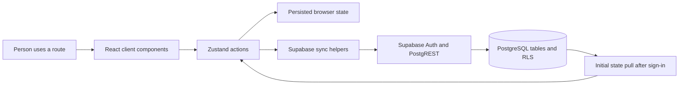

# Trelis Life — Project Blueprint

> This guide describes the checked-in application as inspected on 31 October 2026. Source code is the implementation evidence. Historical product documents are preserved, but some of their claims do not match the current source. No app runtime, build, lint, database, or deployment was exercised for this documentation review.

## Contents

- [1. Project identity and maturity](#1-project-identity-and-maturity)
- [2. Product experience](#2-product-experience)
- [3. Technology and repository map](#3-technology-and-repository-map)
- [4. Application architecture](#4-application-architecture)
- [5. State and persistence](#5-state-and-persistence)
- [6. Supabase model and sync](#6-supabase-model-and-sync)
- [7. Important logic](#7-important-logic)
- [8. Routes and feature reference](#8-routes-and-feature-reference)
- [9. Local setup](#9-local-setup)
- [10. Debugging guide](#10-debugging-guide)
- [11. Security, privacy, and data boundaries](#11-security-privacy-and-data-boundaries)
- [12. Limitations and review checklist](#12-limitations-and-review-checklist)
- [13. Extension paths](#13-extension-paths)
- [14. Source reference](#14-source-reference)

## 1. Project identity and maturity

Trelis Life is a personal routine and reflection web application. It explores using small, positively framed actions instead of an all-or-nothing habit checklist: a person checks in at the start and end of a day, captures a “win” in a named playlist, and can enable optional writing and task modules.

**Maturity: substantial prototype / work in progress.** This is more than a static mock-up: the repository contains routed interfaces, interactive Zustand actions, browser persistence, email/password auth flows, Supabase query and mutation helpers, and SQL migrations. However, source inspection cannot establish that the current code builds, that the expected remote schema exists, or that authentication, sync, and hosting work together in a live environment. There is no checked-in automated test suite or test script. No production deployment was verified.

The project is best presented as an implemented product experiment with a clear interface and several connected data paths, not as a verified production health product or a proven offline-first service.

## 2. Product experience

The root dashboard is the central surface. It presents a morning “feet on floor” interaction, an optional sleep/mood routine, an evening reflection, win/playlists progress, a vision statement, and navigation to settings and enabled optional modules. The interface changes its palette with the local time of day.

The current source uses these concepts:

| Concept | Meaning in the application |
| --- | --- |
| The Arc / daily bookends | Morning and evening actions and reflection on the dashboard. The persisted state has separate flags and values for each. |
| Playlist | A user-named category for organizing logged moments. It is represented in the store as a playlist with nested `gems`. |
| Gem / win | A dated, optionally labeled and tagged entry attached to a playlist. This is also referred to as a small win in the UI. |
| Journal, To-do, Notes Vault | Optional routes controlled by three store flags and settings/onboarding controls. |
| Quiet Partner | A social feature that queries a partner relation, displays a small activity indicator row, and supports preset nudges. |

Some supporting types, templates, SQL history, and older documents still use “anchor”, “keep”, “gather”, pillar, or other earlier vocabulary. The current interface maps playlist entries to Supabase `user_anchors` and `anchor_gathers`; those names reflect the database transition, not a single consistent product vocabulary.

### Typical data path



This diagram describes code connections, not a verified live deployment. Local state updates occur before several remote writes, and sync helper errors are logged rather than placed in a durable retry queue.

## 3. Technology and repository map

| Layer | Evidence in repository |
| --- | --- |
| Framework / routing | Next.js 16 App Router (`package.json`, `src/app/`) |
| UI | React 19, TypeScript, Tailwind CSS 4, Framer Motion, Lucide icons |
| Client state | Zustand 5 and `zustand/middleware` persistence |
| Auth / cloud data | Supabase JS and `@supabase/ssr` browser client |
| Dates | Native `Date` and `date-fns` in UI helpers |
| Static/web metadata | `next.config.ts`, `public/manifest.json`, `vercel.json` |

Relevant directories:

```text
src/
  app/                 App Router pages and global layout/styles
  components/core/     Dashboard, theme/lifecycle, partner, and shared cards
  components/rituals/  Morning/evening UI elements
  components/widgets/  Playlist, quick-log, and vision controls
  lib/supabase/        Browser client and cloud read/write helpers
  lib/                 Templates and a payment placeholder
  store/               Persisted Zustand application state
  utils/               Date, streak, prompt, and legacy starter helpers
supabase/
  migrations/          Incremental SQL changes and RLS policies
  seed_phase4_protocol.sql  Seed script; public-data review required
```

The root `README.md` is now a concise portfolio entry point. [`USER_MANUAL.md`](./USER_MANUAL.md) and [`TRELIS_LIFE_SOURCE_OF_TRUTH.md`](./TRELIS_LIFE_SOURCE_OF_TRUTH.md) are retained historical references; descriptions such as passwordless login, a fully offline PWA, or a previous anchor workflow should not be assumed current without matching code evidence.

## 4. Application architecture

### Component layers

1. **Route layer — `src/app/`:** each route composes client-side forms and feature components. The root route handles persisted-state hydration and Supabase auth state before showing the landing/dashboard flow.
2. **Feature components — `src/components/`:** smaller units own UI interactions such as check-ins, playlist editing, quick logging, vision editing, theme changes, and partner presence.
3. **State layer — `src/store/useRitualStore.ts`:** defines the product state and actions. Mutations generally update Zustand first, then call an imported sync helper for supported records.
4. **Integration layer — `src/lib/supabase/`:** `client.ts` creates a browser Supabase client using public environment variables; `syncEngine.ts` performs per-user queries, upserts, and deletes.
5. **Database layer — `supabase/migrations/`:** incremental SQL modifies an assumed existing schema, adds app tables and policies, and includes legacy triggers/policies. The full base schema and a reproducible local Supabase project configuration are not present in the inspected tree.

### Root route lifecycle

`src/app/page.tsx` waits for Zustand persistence hydration and listens to Supabase Auth state. For an authenticated user it starts `syncPullInitialState` in the background; if onboarding is incomplete it routes to `/onboarding`. Once signed in, the dashboard loads additional user state and metadata, evaluates a prior-day streak, and renders dashboard sections. If unauthenticated, the root flow shows the landing experience.

`AppLifecycleManager` in `src/components/core/AppLifecycleManager.tsx` compares the stored local date with today after hydration, resets selected daily fields at a date boundary, polls every second, and rechecks when the browser tab becomes visible. `CircadianProvider` derives a theme from the device’s local hour and checks every five minutes.

## 5. State and persistence

The store is created in `src/store/useRitualStore.ts` and persisted under the browser storage key `trelis-life-ritual-storage`. It includes:

- Daily flags and values: wake time, feet-on-floor, morning check-in, sleep and mood scores, bed time/duration, evening check-in, win text, and parking-lot note.
- Collections: playlists, nested gems, journal entries, todos, and vault notes.
- Preferences and progression: vision text/visibility, module toggles, rest-day flag, streak values, weekly history, onboarding flags, and selected focus IDs.

The `persist` middleware uses its default browser storage behavior (local storage). Most actions update state synchronously, so the UI can reflect a change without waiting for the network. However, this does **not** guarantee complete offline behavior: records without UUID IDs are skipped by some cloud pushes, a failed push is not queued for retry, and new local storage state is not automatically migrated to a remote account.

The `resetDaily` action clears a subset of daily values and keeps playlist definitions. It updates the local last-active date. It does not itself call the remote daily sync helper.

### Example: log a Gem

At a high level, a user chooses a playlist and submits an optional label/tag from `QuickLogDrawer` or `PlaylistCard`:

1. The store creates a UUID, local date string, and Gem object.
2. Zustand appends that Gem to the chosen playlist and persists the changed store.
3. `syncPushGem` asks Supabase Auth for the current session.
4. If there is no session or an ID is not a UUID, the helper returns without a database write.
5. Otherwise it upserts a row into `anchor_gathers` using the Gem ID as the conflict key.

The write is best-effort. The store action does not await a durable outbox or surface a retry state.

## 6. Supabase model and sync

### Client and credentials

`src/lib/supabase/client.ts` calls `createBrowserClient` with `NEXT_PUBLIC_SUPABASE_URL` and `NEXT_PUBLIC_SUPABASE_ANON_KEY`. It configures Auth session persistence in browser local storage, token refresh, PKCE, and URL-session detection off. No `.env.example` is checked in. The anon/publishable client key is intended for browser use; database access depends on correct Supabase RLS. Never put a service-role key in a `NEXT_PUBLIC_*` variable.

### Tables referenced by current code

| Table | Use visible in code |
| --- | --- |
| `daily_rituals` | Daily check-in values, reflections, and a pulse score; upserted by user/date. |
| `user_anchors` | Playlist/category records and some metadata. |
| `anchor_gathers` | Gem/win rows associated with an anchor/playlist. |
| `user_vision` | Per-user vision text. |
| `user_state` | Onboarding/module flags, streak and pause-token fields. |
| `journal_entries`, `todos`, `vault_notes` | Optional-module data and CRUD paths. |
| `quiet_partners`, `partner_nudges` | Partner links, activity indicators, and preset nudges. |
| `anchor_keeps`, `anchor_logs`, `plus_waitlist` | Appearing in migrations or legacy code; not evidence that all related experiences are current or operational. |

The migration directory is incremental and assumes a preexisting database. Files add `user_state` and anchor fields, archive-table policies, a trigger, partner/nudge and waitlist tables/policies, and newer `anchor_keeps`/`anchor_gathers` tables. They do not constitute a complete, clean-room schema or verify the deployed database. Some policy additions refer to tables created elsewhere or use authorization rules that require careful review.

### Pull and push behavior

`syncPullInitialState` runs from the root auth listener after sign-in. It requests today’s ritual, a recent history slice, vision, anchors, gathers, user state, and optional-module records. The code comment says “Local data always wins,” but actual merging differs by field:

- For some daily fields, cloud values fill only local values considered incomplete.
- Cloud vision replaces the local value only when the local value equals the default phrase.
- Anchors replace an empty/default local list; otherwise some flags are merged by ID.
- Gems are rebuilt when IDs/count differ.
- Journal entries, todos, notes, and module flags can be assigned from the cloud response directly.

This is a field-specific merge, not a general conflict-resolution system. Sync helpers generally use Supabase upserts for writes and scoped deletes for some record types. Playlist pushes upsert current rows but do not delete cloud rows removed locally. Error handling mostly writes to the browser console, and the application has no durable queue or clear sync-status UI.

### Migration and seed boundaries

The migration SQL is source code only. This documentation audit did not execute SQL or connect to Supabase. [`supabase/seed_phase4_protocol.sql`](./supabase/seed_phase4_protocol.sql) is specifically flagged for **separate public-data review**: its contents may include personal data and include data-changing statements. Its provenance and safety are unresolved. Do not classify it as harmless or synthetic, and do not run or republish its records until an authorized review determines the appropriate handling.

## 7. Important logic

### Day rollover

The app forms local date keys using `toLocaleDateString('en-CA')` in several places. `AppLifecycleManager` compares these keys with `lastActiveDate`, then calls `resetDaily` when the key advances. The interval and visibility listener allow a tab left open overnight to notice the date change. This implementation has not been tested across time zones, daylight-saving transitions, or suspended mobile browsers.

### Pulse and streak evaluation

`syncPushDailyRitual` computes a score from two booleans (`feetOnFloorLogged` and `eveningCheckInDone`) and writes the resulting percentage. `evaluateYesterdayStreak` reads yesterday’s `pulse_score`; a score at or above 30 increments the streak, a lower score consumes an available pause token, and otherwise resets the streak. It updates `user_state` with an upsert. The dashboard also stores a per-user, per-day evaluation marker in browser local storage.

Interpret this as implemented logic, not a validated business rule: the client triggers the evaluation, date construction uses local time, failure is logged, and the dashboard marker is written after the attempted evaluation even if the call fails.

### Quiet Partner

The component polls every 30 seconds. It queries active partner rows, the partner’s active anchors and today’s gathers, then renders up to six completion dots. It also loads unread nudges and supports sending/dismissing preset messages. The intended data boundary relies on database RLS, including partner read policies in the migrations. Neither policy correctness nor behavior with two real accounts was tested.

### “Total wins” label

`getTotalWins` adds a `historicalTotalWins` value, a same-day feet-on-floor flag, and labeled gems in active playlists for today. The dashboard separately fetches a count of older `anchor_gathers` rows and stores it in `historicalTotalWins`. This is an implementation detail; the label should not be described as a verified lifetime metric without reconciling all record types and date windows.

## 8. Routes and feature reference

| Route | File | Source-backed purpose |
| --- | --- | --- |
| `/` | `src/app/page.tsx` | Auth-aware landing/dashboard; daily interactions and module navigation. |
| `/login` | `src/app/login/page.tsx` | Email/password sign-in, account creation, password reset. |
| `/auth/callback` | `src/app/auth/callback/page.tsx` | Exchanges an auth callback code and navigates to the requested path. |
| `/update-password` | `src/app/update-password/page.tsx` | Password update form. |
| `/onboarding` | `src/app/onboarding/page.tsx` | Wake/sleep preferences, playlist choices, and optional modules; writes initial user state. |
| `/wins` | `src/app/wins/page.tsx` | Active playlist list, playlist management, and today’s win summary. |
| `/debrief` | `src/app/debrief/page.tsx` | Sunday-gated reflection form; logs the combined text as a Gem. |
| `/settings` | `src/app/settings/page.tsx` | Preferences, module toggles, partner actions, sign-out, and a destructive account-data reset. |
| `/journal` | `src/app/journal/page.tsx` | Journal-entry UI backed by local store and sync helper. |
| `/todo` | `src/app/todo/page.tsx` | To-do CRUD UI backed by local store and sync helper. |
| `/notes` | `src/app/notes/page.tsx` | Notes CRUD UI backed by local store and sync helper. |

`/settings` contains a data-erasure path that deletes selected remote tables and calls `localStorage.clear()`. It should be treated as destructive and reviewed before use: source inspection does not show a comprehensive transaction across all app tables, and the browser storage clear is origin-wide. Do not use this control casually.

## 9. Local setup

### Prerequisites

- Node.js and npm compatible with the versions required by the installed Next.js release.
- A Supabase project with Auth configured and the complete schema/policies expected by this source. The checked-in migrations are not a complete base schema.
- Project-specific callback/redirect URLs configured in Supabase Auth for local development.

### Steps

1. Clone the repository and install dependencies with `npm install`.
2. Create an untracked `.env.local` in the repo root containing your own `NEXT_PUBLIC_SUPABASE_URL` and `NEXT_PUBLIC_SUPABASE_ANON_KEY`.
3. Ask the database owner to provision/verify the expected schema and RLS. Review migrations before applying them. Do not run the seed SQL while its data provenance is unresolved.
4. Start the development server with `npm run dev` and open `http://localhost:3000`.
5. Use a disposable test account and test database when validating authentication or CRUD flows.

Available package scripts are `dev`, `build`, `start`, `lint`, and `build:mobile`. This audit did not run any of them. `build:mobile` invokes Capacitor commands, while Capacitor packages/configuration are not present in the inspected manifest/tree; treat it as stale or unverified. `next.config.ts` requests static export while also declaring response headers; compatibility with the intended export/deployment path needs a real build and hosting check.

## 10. Debugging guide

1. **Start with hydration:** inspect the browser console and verify Zustand has hydrated before diagnosing date resets or root-route state.
2. **Check configuration:** confirm the two public Supabase environment variables are present and point to the intended development project. A missing URL/key prevents client initialization or remote requests.
3. **Follow a write:** inspect the relevant store action, then its `syncPush…` helper, the Supabase response, and the table’s RLS policy. Helpers catch and log many errors instead of surfacing them in the UI.
4. **Check IDs:** cloud sync helpers skip locally generated records unless their IDs are valid UUIDs. Check whether the parent playlist/record has already synced.
5. **Check merge semantics:** `syncPullInitialState` does not apply one consistent “local always wins” rule. Compare the specific state field’s branch before treating a pull as a merge bug.
6. **Check dates:** daily records use local date strings in several modules; compare device date/time zone with the database `date`/`log_date` values.
7. **Check authorization:** validate RLS with a normal authenticated test user. A successful UI interaction alone does not prove the database policy is correctly scoped.
8. **Separate local and remote state:** browser local storage can preserve an entry even when a cloud write fails. Verify both layers independently before concluding that data is synchronized.

No debug scenario above was executed as part of the documentation pass.

## 11. Security, privacy, and data boundaries

- The Supabase browser client receives public environment values. RLS is the critical boundary for database rows; review policies and deployed schema rather than relying on hidden UI controls.
- Journal entries, notes, mood/sleep check-ins, reflections, and partner relationships are personal data categories. Treat both local storage and Supabase rows accordingly.
- Local storage is accessible to scripts running in the origin and remains on the device until cleared. The settings reset clears all local storage, not just this application’s Zustand key.
- The migration set contains owner-scoped RLS policies and partner exceptions. Verify that partner access reveals only the intended records and that query results respect the policy design.
- No live Supabase connection, production key, external endpoint, or database state was accessed during this work.
- The seed script’s provenance is unresolved. Keep it out of public documentation content and do not execute it pending a separate public-data review.

## 12. Limitations and review checklist

| Area | What source inspection establishes | What remains unverified or limited |
| --- | --- | --- |
| Runtime quality | Routes and handlers are implemented in source. | No build, lint, browser session, or automated tests were run. |
| Auth | Supabase email/password, sign-up, reset, callback, and update flows are coded. | Redirect setup, email delivery, real sign-in, and route protection were not validated. |
| Offline behavior | Zustand persists local app state. | No service worker or durable sync queue; cloud writes can fail silently from the user’s perspective. |
| Conflict handling | Initial cloud pull has per-field conditions. | Not a general conflict algorithm; some arrays are replaced from cloud and local deletes do not remove all remote rows. |
| Database | Incremental migrations and table operations exist. | Base schema and deployed project are absent; migrations/policies may rely on earlier state. |
| Streaks | Client-side threshold logic and pause-token data fields exist. | Rollover race/failure behavior and intended scoring semantics have not been validated. |
| PWA/deployment | A manifest, static export setting, and Vercel header config exist. | No service worker; build/export/header compatibility and deployment are unverified. |
| Native mobile | A mobile build script name remains. | Capacitor dependency/configuration is not present in the inspected source tree. |
| Payments | A Razorpay utility file exists. | It is a placeholder that reports billing is deprecated; no working payment integration is evidenced. |
| Historical guidance | Manuals and source-of-truth notes are retained. | They contain stale/conflicting descriptions; follow the current code and this audit. |
| Seed data | A seed script exists. | Provenance/public safety is unresolved; separate review required before publication or execution. |

### Before calling this production-ready

- Resolve the seed-file data review and decide whether it should remain public in its current form.
- Provision a clean test Supabase project from documented, complete migrations and verify every RLS policy, including partner exceptions.
- Add automated tests for core store logic, date boundaries, sync/merge behavior, auth, and destructive settings actions.
- Add visible sync/error states and a retry/outbox strategy if offline use is a product requirement.
- Verify responsive/accessibility behavior, password reset redirects, deployment output, and security headers on the intended host.
- Reconcile legacy manuals and package scripts with the current implementation.

## 13. Extension paths

The code suggests practical improvements without implying they already exist:

1. **Define a canonical domain model.** Separate current playlist/Gem concepts from legacy anchors/keeps and document a migration path.
2. **Make synchronization observable.** Add per-record pending/synced/error state, retries, and explicit conflict rules instead of console-only failure handling.
3. **Create reproducible database setup.** Include a clean baseline schema, migration instructions, and safe synthetic fixtures isolated from any personal data.
4. **Test time logic.** Use an injectable clock/time zone and cover midnight, missed-day, and daylight-saving cases.
5. **Harden authorization flows.** Verify route-level access, partner consent/removal, and least-privilege RLS using multiple test accounts.
6. **Align deployment configuration.** Choose static export or server hosting deliberately and validate headers, auth callbacks, and any required runtime routes.

## 14. Source reference

- [Root route and dashboard orchestration](./src/app/page.tsx)
- [Root layout and global providers](./src/app/layout.tsx)
- [Persisted store and domain actions](./src/store/useRitualStore.ts)
- [Supabase browser client](./src/lib/supabase/client.ts)
- [Initial pull and record sync helpers](./src/lib/supabase/syncEngine.ts)
- [Date-based streak evaluation](./src/utils/streakEngine.ts)
- [Day matching helper](./src/utils/dayMatcher.ts)
- [Ritual UI components](./src/components/rituals/)
- [Optional-module routes](./src/app/journal/page.tsx), [to-do](./src/app/todo/page.tsx), and [notes](./src/app/notes/page.tsx)
- [Incremental database migrations](./supabase/migrations/)
- [Seed script requiring public-data review](./supabase/seed_phase4_protocol.sql)
