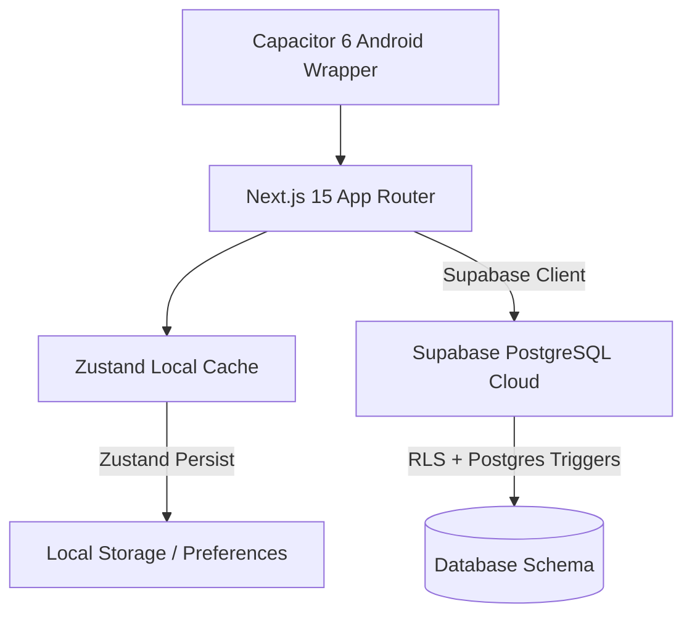

# TRELIS LIFE - PHASE 4 "AS-BUILT" MASTER TECHNICAL SPECIFICATION
*Document Version: 1.0.0*  
*Classification: Confidential — Engineering Source of Truth*  
*Base Timestamp: May 2026*  

This document serves as the absolute "As-Built" master specification detailing the fully realized, compiled, and production-tested state of the Trelis Life application at the completion of **Phase 4**. All core systems, timezone alignments, database schemas, cryptographic boundaries, gamification algorithms, and UI rules defined herein are locked and validated. This document establishes the sole blueprint and architectural foundation for Phase 5.

---

## 1. Executive Summary & Locked Architecture

Trelis Life is engineered not as a tracking application, but as a clinical **Life Operating System** built with strict offline-first robustness, local-first responsiveness, and cloud synchronization. 

### The Locked Technology Stack
- **Frontend Architecture:** Next.js 15 (App Router, Turbopack Bundler, React 19).
- **Styling Paradigm:** Tailwind CSS + Framer Motion (respecting `prefers-reduced-motion` settings).
- **State Management:** Zustand + Zustand Persist (Offline-first localStorage adapters).
- **Backend & Database:** Supabase (PostgreSQL 15, Realtime Client, Row-Level Security, Database Triggers).
- **Mobile Container:** Capacitor 6 (Native Android Wrapper).



### The Dual-Layer Capacitor Auth Override
To eliminate cold-launch layout flashes and cookieless Android WebView synchronization latency, Trelis Life implements a custom dual-layer Capacitor storage client override inside `src/lib/supabase/client.ts`.

1. **Native Preference Adapter:** When executing within a native Capacitor wrapper (`Capacitor.isNativePlatform()`), the Supabase client shifts storage persistence entirely to native OS preferences (`@capacitor/preferences`).
2. **Standard LocalStorage Fallback:** On standard web boundaries, standard `localStorage` is maintained.
3. **PKCE Flow & Silent Sync:** Session handling utilizes secure **PKCE** (Proof Key for Code Exchange). On auth state resolution (`SIGNED_IN`), the sync engine invokes a silent background pull (`syncPullInitialState`) to backfill the local Zustand cache from the cloud without blocking the UI thread.
4. **The `isAuthLoading` Skeleton Guard:** A client layout guard in `src/app/page.tsx` prevents the rendering of dashboard widgets until the Zustand store is fully hydrated from local storage (`hasHydrated = true`) and auth listener completes (`isAuthLoading = false`).

#### Implementation Code: `src/lib/supabase/client.ts`
```typescript
import { createBrowserClient } from '@supabase/ssr';
import { Preferences } from '@capacitor/preferences';
import { Capacitor } from '@capacitor/core';

const capacitorStorage = {
  getItem: async (key: string) => {
    const { value } = await Preferences.get({ key });
    return value;
  },
  setItem: async (key: string, value: string) => {
    await Preferences.set({ key, value });
  },
  removeItem: async (key: string) => {
    await Preferences.remove({ key });
  },
};

export function createClient() {
  return createBrowserClient(
    process.env.NEXT_PUBLIC_SUPABASE_URL!,
    process.env.NEXT_PUBLIC_SUPABASE_ANON_KEY!,
    {
      auth: {
        storage: Capacitor.isNativePlatform() 
          ? capacitorStorage 
          : (typeof window !== 'undefined' ? window.localStorage : undefined),
        autoRefreshToken: true,
        persistSession: true,
        detectSessionInUrl: false,
        flowType: 'pkce',
      }
    }
  );
}
```

---

## 2. Database & Schema State

The relational database architecture is defined in Postgres, enforced by strict Row-Level Security, and extended by automatic triggers.

```
+-------------------------------------------------------------+
|                        DATABASE SCHEMA                      |
+-------------------------------------------------------------+
|                                                             |
|  +--------------------+             +--------------------+  |
|  |     user_state     |             |    user_anchors    |  |
|  +--------------------+             +--------------------+  |
|  | user_id (PK, UUID) |<---------+  | id (PK, UUID)      |  |
|  | pause_tokens (INT) |          |  | user_id (FK, UUID) |  |
|  | current_streak(INT)|          |  | title (TEXT)       |  |
|  | longest_streak(INT)|          |  | is_non_neg (BOOL)  |  |
|  | lifetime_count(BIG)|          |  | baseline_trg (INT) |  |
|  | hardest_pillar(TXT)|          |  | sub_items (JSONB)  |  |
|  +--------------------+          |  | frequency (TEXT[]) |  |
|                                  |  +--------------------+  |
|  +--------------------+          |                          |
|  |    anchor_logs     |          |  +--------------------+  |
|  +--------------------+          |  |  anchors_archive   |  |
|  | id (PK, UUID)      |          |  +--------------------+  |
|  | user_id (FK, UUID) |----------+  | id (PK, UUID)      |  |
|  | completed (BOOL)   |             | user_id (FK, UUID) |  |
|  | date (DATE)        |             | archived_at (DATE) |  |
|  +--------------------+             +--------------------+  |
|                                                             |
+-------------------------------------------------------------+
```

### The `user_anchors` Schema
Enforces standard custom and system anchor configurations.
- `sub_items` (*JSONB*): An array of objects representing checklist stacks, e.g., `[{"id": "s1", "title": "Hydrate morning", "completed": false}]`.
- `frequency` (*text[]*): A weekday frequency schedule constraint array containing abbreviation tags, e.g., `['Mon', 'Wed', 'Fri']` or `['all']`.

### The `user_state` Schema
Tracks streaks, priorities, and gamification tokens.
```sql
CREATE TABLE IF NOT EXISTS public.user_state (
  user_id uuid PRIMARY KEY REFERENCES auth.users ON DELETE CASCADE,
  pause_tokens_remaining int DEFAULT 2 CHECK (pause_tokens_remaining >= 0 AND pause_tokens_remaining <= 3),
  pause_tokens_reset_on date DEFAULT (date_trunc('month', now()) + interval '1 month')::date,
  current_streak int DEFAULT 0 CHECK (current_streak >= 0),
  longest_streak int DEFAULT 0 CHECK (longest_streak >= 0),
  lifetime_anchor_count bigint DEFAULT 0 CHECK (lifetime_anchor_count >= 0),
  hardest_pillar text,
  hardest_pillar_until date
);
```

### The `anchors_archive_2026_05` Schema
Historical partitioning table capturing deleted or deactivated anchors for historical integrity and backfilled trendlines.
```sql
CREATE TABLE IF NOT EXISTS public.anchors_archive_2026_05 (
  id uuid PRIMARY KEY,
  user_id uuid REFERENCES auth.users ON DELETE CASCADE,
  title text NOT NULL,
  pillar_id text NOT NULL,
  archived_at timestamp with time zone DEFAULT now()
);
```

### The Lifetime Completed Anchor Count Trigger
To guarantee that user lifetime achievement stats are immutable and updated server-side, a Postgres database trigger monitors completed logs:
```sql
CREATE OR REPLACE FUNCTION public.handle_anchor_completion_increment()
RETURNS TRIGGER AS $$
BEGIN
  IF NEW.completed = true AND (TG_OP = 'INSERT' OR OLD.completed = false) THEN
    INSERT INTO public.user_state (
      user_id,
      pause_tokens_remaining,
      current_streak,
      longest_streak,
      lifetime_anchor_count
    )
    VALUES (
      NEW.user_id,
      2,
      0,
      0,
      1
    )
    ON CONFLICT (user_id) DO UPDATE
    SET lifetime_anchor_count = public.user_state.lifetime_anchor_count + 1;
  END IF;
  RETURN NEW;
END;
$$ LANGUAGE plpgsql SECURITY DEFINER;

CREATE TRIGGER on_anchor_log_completed
  AFTER INSERT OR UPDATE ON public.anchor_logs
  FOR EACH ROW
  EXECUTE FUNCTION public.handle_anchor_completion_increment();
```

### Enforced Row-Level Security (RLS) Policies
Every relational database table is protected by a standard Owner Isolation Rule:
```sql
-- 1. Enable RLS on User State
ALTER TABLE public.user_state ENABLE ROW LEVEL SECURITY;

CREATE POLICY "user_state_owner" ON public.user_state
  FOR ALL TO authenticated
  USING (auth.uid() = user_id)
  WITH CHECK (auth.uid() = user_id);

-- 2. Enable RLS on History Archive
ALTER TABLE public.anchors_archive_2026_05 ENABLE ROW LEVEL SECURITY;

CREATE POLICY "Users can only read their own archives" 
  ON public.anchors_archive_2026_05
  FOR SELECT TO authenticated
  USING (auth.uid() = user_id);
```

### Supabase Database Security Lockdown & Mutability Patch
- **Trigger Security Patch (`20260524_security_linter_patch.sql`):** Applied secure database-level linter DDL rules per Supabase security protocols:
  1. Configured strict explicit search paths (`SET search_path = public`) for `public.handle_new_user()` and `public.handle_anchor_completion_increment()` database triggers to prevent hijack threats via mutable execution paths.
  2. Revoked public execute privileges (`REVOKE EXECUTE`) from default `PUBLIC`, `anon`, and `authenticated` roles for both internal trigger functions to strictly prevent external REST API RPC invokes.

---

## 3. The Dynamic Anchor Engine & Pulse Score

The core metric of Trelis Life is the **Pulse Score**, a weighted index out of 100 mapping circadian check-ins and habits.

### Asymmetrical Math Weights
Rather than standard linear averaging, the Pulse Score is heavily asymmetric, prioritizing habit actions over self-report metrics:
1. **Morning Check-In (10% weight):** Wake time, wake mood, and "Feet on Floor" physical alignment. Max score component: **10 points**.
2. **Evening Check-In (20% weight):** Circadian wind-down alignment and reflection. Max score component: **20 points**.
3. **Daily Anchor Engine (70% weight):** Completed daily anchors. Max score component: **70 points** (dynamically distributed evenly across active daily anchors).

$$\text{Pulse Score} = \text{Morning Score (10)} + \text{Evening Score (20)} + \text{Engine Score (70)}$$

### Asymmetric Daily Grading Tiers
Daily accomplishments map to precise circadian grades, rendering dynamic accent rings:
- **90–100: Peak Day** (Gold accent `#D4AF37`) $\rightarrow$ All check-ins and anchors completed.
- **75–89: Strong Day** (Silver accent `#A0A0A0`) $\rightarrow$ Substantial alignment, minor anchor slip.
- **55–74: Steady Day** (Teal accent `#2A7F7F`) $\rightarrow$ Baseline clinical habit maintenance.
- **30–54: Light Day** (Green accent `#52BE80`) $\rightarrow$ "Anchors that landed today" — Minimal checklist completion.
- **0–29: Rest Day** (Muted Slate `#85929E`) $\rightarrow$ "Tomorrow is a new day." — Circadian recovery window.

### Timezone-Safe Local Day Matcher
Trelis Life maps JS numeric day indexes safely to database strings on the device's local timezone. This guarantees timezone-safe day matching for Sunday-start locales and eliminates GMT off-by-one errors.

#### Implementation Code: `src/utils/dayMatcher.ts`
```typescript
export const getLocalDayString = (date: Date = new Date()): string => {
  const dayIndex = date.getDay(); // 0 (Sun) to 6 (Sat)
  const dayMap: Record<number, string> = {
    0: 'Sun',
    1: 'Mon',
    2: 'Tue',
    3: 'Wed',
    4: 'Thu',
    5: 'Fri',
    6: 'Sat'
  };
  return dayMap[dayIndex] || 'all';
};

export const isAnchorActiveForDay = (frequency?: string[], date: Date = new Date()): boolean => {
  if (!frequency || frequency.length === 0 || frequency.includes('all') || frequency.includes('All')) {
    return true;
  }
  const localDayStr = getLocalDayString(date);
  return frequency.includes(localDayStr);
};
```

---

## 4. Gamification & The Streak Engine

Daily streak continuity is governed by a rigorous evaluation utility that executes on App launch or daily boundary crossings.

### Streak Evaluation Rules
- **Yesterday Evaluation:** Calculates yesterday's local date string `YYYY-MM-DD`.
- **Completion Check:** Fetches yesterday's `pulse_score`.
- **Streak Increment:** If the score is $\ge 30$, `current_streak` increments by 1. If `current_streak` exceeds `longest_streak`, the high-water mark updates.
- **Pause Token Forgiveness:** If the score is $< 30$ and the user has `pause_tokens_remaining > 0`, the token decays by 1, and `current_streak` is protected.
- **Reset:** If the score is $< 30$ and `pause_tokens_remaining = 0`, the streak resets to 0.

#### Implementation Code: `src/utils/streakEngine.ts` (Core Logic)
```typescript
if (yesterdayScore >= 30) {
  newStreak = oldStreak + 1;
  if (newStreak > oldLongest) {
    newLongest = newStreak;
  }
  actionTaken = 'increment';
} else {
  if (oldTokens > 0) {
    newTokens = oldTokens - 1;
    actionTaken = 'paused';
  } else {
    newStreak = 0;
    actionTaken = 'reset';
  }
}
```

### The Three-Layer Forgiveness System
Trelis Life implements clinical habit psychology to prevent discouragement:
1. **Pause Tokens (Dynamic Protection):** Standard 2-token buffer (up to 3 max), resetting at the beginning of each calendar month.
2. **Sprout 🌱 to Flame 🔥 Transition:** Standard streaks represent "Peak / Strong / Steady" days ($\ge 55$ score) as an active **Flame 🔥**. If the day is a "Light Day" ($30\text{--}54$ score), the streak transitions visually to a **Sprout 🌱**, indicating maintenance without pressure.
3. **Permanent Lifetime Anchors:** Implemented at the DB level, creating an additive lifetime score that never resets, reinforcing the user's permanent historical progress.

### Non-Negotiable Anchor UI Bounds
Critical daily anchors are flagged as non-negotiable:
- **Incomplete State:** The left border turns a high-contrast solid crimson `#E04C3C` to trigger a psychological urge to close the loop.
- **Complete State:** The left border transitions smoothly to a calm, soft success green (`rgba(52, 199, 89, 0.4)` / `#34C759`), signaling cognitive release.

---

## 5. New Phase 4 Routes & Features

### Onboarding Flow (`src/app/onboarding/page.tsx`)
A frictionless 5-screen mobile-first setup:
1. **Welcome ("Hi."):** Establishes the core philosophy.
2. **The 6 Pillars Grid:** Educates the user on the MECE Pillars.
3. **Wake Window Picker:** Sets sleep/wake cycles to pre-populate checklist stacks.
4. **Friction Check:** Asks which pillar is hardest, saving it as `hardest_pillar` in `user_state`.
5. **Starter Template Injection:** Automatically injects the 8-anchor default template into local Zustand and syncs baseline parameters to Supabase.

#### Injected Default Templates:
- Nutrition: *Drink 2.5L water today* (Baseline: 5 glasses)
- Nutrition: *30g protein at 2+ meals* (Baseline: 2 meals)
- Movement: *7,000 steps* (Baseline: 7000 steps)
- Movement: *20-8-2 desk rule (8 cycles)* (Baseline: 8 cycles)
- Sleep: *In bed by 23:00 (8-hour opportunity)*
- Stress & Mental: *Evening Reflection* (Reflection prompt: "win, drain, priority")
- Social: *One real conversation today*
- Environment: *10 minutes of sunlight* (Baseline: Sit by window)

### "Notes of Life" Stoic Journal (`src/app/notes/page.tsx`)
A digital Stoic diary featuring a premium paper layout:
- **Minimalist Search Bar:** Fast text filter querying anchor prompts, notes, and topics.
- **Double-Row Horizontal Filter System:** A snap-scrolling pillar selector coupled with a horizontal hashtag chip controller that automatically parses hashtags (e.g. `#wins`, `#drains`, `#ideas`, `#lessons`) from the user's journal entries.
- **Sorting Toggle:** Clean, animated sorting button for chronological transitions.
- **Luxury Serif Typography:** Reflection copy uses a soft serif typeface (`font-serif tracking-wide text-ink-primary leading-relaxed text-sm`) mimicking a physical wellness notebook.

### History View (`src/app/history/page.tsx`)
An analytical, clean health dashboard:
- **SVG Sparkline:** A 30-day Trend `<polyline>` chart tracking Daily Pulse. Free from gridlines or distraction.
- **MECE Pillar Heatmap:** A 14-day grid mapping the MECE Six Pillars. Columns represent days; rows represent pillars. Daily completion density regulates the clinical teal opacity (`#2A7F7F`).

### Sunday Weekly Debrief (`src/app/debrief/page.tsx`)
Time-gated to Sundays (`getDay() === 0`), this route intercepts the user and prompts three simple questions:
1. *What worked this week?* (Identifies stable habit cues)
2. *What broke down?* (Pinpoints environmental friction)
3. *One change for next week.* (Actions a minor adjustment)

Upon submission, answers are formatted as a Type B reflection log under the Stress & Mental pillar, resetting the weekly review metric.

### Circadian Vision Priming (`src/components/VisionPrimer.tsx`)
Active exclusively between **06:00 and 10:00 local time**, this lock widget displays the user's daily morning intention statement over a gradient background (`#1A3636` to `#1C1C1E`) and a glowing radial sun orb. It is dismissible for the remainder of the session to clear cognitive load.

---

## 6. UI/UX Master Polish Variables

Trelis Life adheres to a "world-class calm" design system, utilizing precise micro-animations, color tokens, and layout ratios.

### Apple-Grade Dampened Spring Curves
To prevent jarring UI changes, all collapsible pillars, checkbox expands, and drawer slides utilize specific Framer Motion spring values:
```typescript
transition={{ type: "spring", stiffness: 300, damping: 30 }}
```

### Color Palette Tokens
- `bg-canvas` (`#F7F6F2`): A soft, warm paper background.
- `bg-surface` (`#FFFFFF`): Elevated widget layers.
- `text-ink-primary` (`#1C1C1E`): High-contrast primary charcoal text (never pure black).
- `text-ink-secondary` (`#5C5C5E`): Muted slate gray secondary text.
- `bg-accent-teal` (`#2A7F7F`): Positive circadian habits.

### Depth Elevation Variables
All core dashboard elements use a spacious border and shadow combination:
- **Drop Shadows:** `shadow-[0_4px_20px_-4px_rgba(0,0,0,0.05),0_1px_3px_rgba(0,0,0,0.02)]`
- **Muted Inner Borders:** `border border-muted/80`
- **Layout Padding:** Spacious padding (`p-5` or `p-6`) provides ample breathing room and prevents layout overcrowding.

---

## 7. Go-To-Market & Compliance

### Google Play Store Compliance
To satisfy Google Play Developer Console requirements for Health and Wellness Applications, the following medical disclaimer is statically injected in a highly legible but unobtrusive text format into the footers of the Login (`src/app/login/page.tsx`) and Settings (`src/app/settings/page.tsx`) pages:

> "Trelis Life is not a medical device and does not diagnose, treat, cure, or prevent any medical condition."

### Supabase 2026 Modern API Key Target
A developer TODO block is positioned in `src/lib/supabase/client.ts`. This block prepares the codebase to migrate to the modern **Supabase Publishable Key architecture** (prefix format `sb_publishable_...`) once legacy anon keys are sunset in late 2026. This migration will require changing the environment variable payload without breaking the underlying browser client loader.

---

## 8. Conclusion

Phase 4 successfully delivers a feature-complete, secure, and visually stunning wellness foundation. The Streak Engine, local day matcher, and polished UI are locked and compiled. 

**This document represents the final, certified state of Phase 4 and is hereby approved as the sole baseline for Phase 5.**
